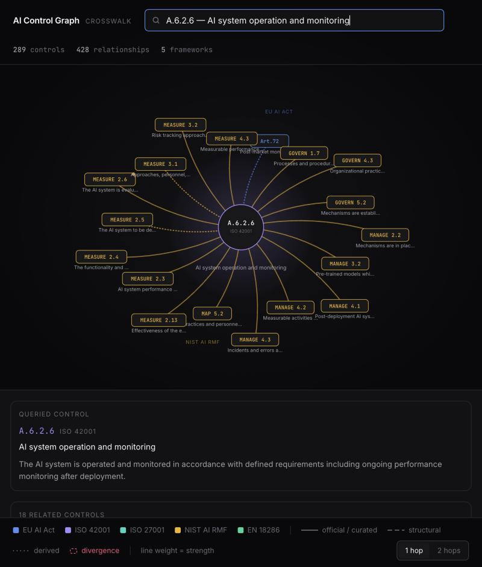

# AI Control Graph

A crosswalk across **ISO/IEC 27001**, **ISO/IEC 42001**, the **EU AI Act** and
the **NIST AI Risk Management Framework**, built as a knowledge graph in
Postgres — where evidence collected from a live AI system is tagged to **one**
control and immediately surfaces every related control in every other framework.

**Live crosswalk: https://ai-control-graph.vercel.app**
**Live estate (the three governed AI systems): https://ai-control-graph-estate.vercel.app**

```
289 controls · 428 relationships · 5 frameworks · no graph database
```



*ISO 42001 A.6.2.6 queried. Solid amber lines are NIST's published crosswalk;
the blue dotted line to EU AI Act Art.72 is derived through the ontology,
because no official article-level NIST↔EU mapping exists.*

---

## The idea in one example

A real prompt-injection probe is fired at a running AI application. The
application refuses. That refusal is collected as evidence and tagged to exactly
one control:

```
EU AI Act Art.15 — Accuracy, robustness and cybersecurity
```

The graph does the rest:

```
→ ISO 27001  A.8.8     Management of technical vulnerabilities   0.60
→ ISO 27001  A.8.24    Use of cryptography                       0.55
→ NIST       MEASURE 2.7  AI system security and resilience      0.54
```

One tag, four frameworks. And when the same mechanism would produce a claim that
is *legally false*, it refuses — see [divergence](#divergence-the-part-that-says-no).

---

## Why four mechanisms, not one

The central finding behind this build: **there is no single way these frameworks
relate to each other.** There are four, they carry different legal weight, and
flattening them into one mapping table destroys the information a reviewer most
needs. Every edge therefore carries a provenance tier.

| Tier | Count | Where it comes from | Judgement |
|---|---|---|---|
| `T1_OFFICIAL` | 280 | NIST's published AI RMF → ISO 42001 crosswalk | none — imported, cited |
| `T2_REGULATORY` | 1 | EU AI Act Art. 40 presumption via OJ-cited harmonised standard | none — legal fact |
| `T3_STRUCTURAL` | 30 | ISO Annex SL shared clause numbering | mechanical |
| `T4_ONTOLOGY` | 99 | derived from a shared concept vocabulary | algorithmic, explainable |
| `T5_CURATED` | 18 | hand-authored, with rationale and author | human |

Three things that fell out of the research, written up in full in
**[docs/CROSSWALK_METHODOLOGY.md](docs/CROSSWALK_METHODOLOGY.md)**:

**NIST's official crosswalk is numbered against the FDIS draft.** Annex A
controls appear as `B.6.2.6`; the published standard renumbers them to
`A.6.2.6`. Import it without normalising and *every Annex A edge points at a
control that does not exist* — silently. There is a test for exactly this.

**There is no article-level NIST ↔ EU AI Act mapping anywhere.** NIST's EU
crosswalk operates at the level of seven trustworthiness characteristics, and
maps the *proposed* Act. Anyone presenting article-level mappings has derived
them. This one derives them too — through an ontology, labelled as derived, in
their own tier.

**ISO 42001 is not a harmonised standard.** Only a standard whose reference is
cited in the Official Journal confers presumption of conformity under Article 40.
Exactly one exists: **EN 18286:2026**, cited by Commission Implementing Decision
(EU) 2026/2274 on 14 October 2026. So every ISO → EU AI Act edge here is typed
`supports`, never `equivalent_to`.

---

## Divergence — the part that says no

A crosswalk that only expresses similarity overstates alignment. This one can
express that two controls address the same subject and **cannot substitute for
one another**, and propagation refuses to cross those edges.

The load-bearing case: evidence of a conforming ISO 42001 management system
propagates to 32 controls — and is blocked from EU AI Act **Art.40**, because
ISO 42001 confers no presumption of conformity. Rendering an ISO certificate as
EU AI Act coverage is the single most dangerous false claim a tool like this
could make, so the block lives in the SQL traversal rather than in the UI, where
anything calling the API directly would lose it.

The divergence stays **visible** when you query the control. Blocked for
propagation, shown for review — different things.

---

## What is actually real

She asked for real systems, not simulations. There is no fixture mode and no
sample-data fallback anywhere in the collection path.

| | |
|---|---|
| **Framework content** | ISO 27001 (93 Annex A + 30 clauses), ISO 42001 (38 Annex A + 32 clauses), EU AI Act (23 provisions), NIST AI RMF (72 subcategories, verbatim) |
| **T1 edges** | parsed from NIST's actual PDF, cached with checksum in [`docs/sources/`](docs/sources/) |
| **AI applications** | three real services — a support chatbot, an **Annex III high-risk** CV screener, a RAG assistant — with PII redaction, injection refusal, rate limiting and machine-readable system cards |
| **Evidence** | live GitHub API, live HTTP probes against the **deployed** apps, live AWS API calls |
| **Propagation** | recursive CTEs over the real graph |

When a source is unavailable, the collector says so and is skipped:

```
aws      skipped — no AWS credentials in environment
```

It never substitutes plausible-looking data. `make doctor` reports exactly what
is degraded and what that costs you.

---

## The parser found bugs in NIST's document

Running the crosswalk parser reports:

```
subcategories : 72  GOVERN 19  MAP 18  MEASURE 22  MANAGE 13
edges         : 281  (202 annex, 79 clause)
annex controls: 38 distinct
disputed      : 3  (source title disagrees with its own reference)
  ! B.3.2 titled 'Management review inputs' but A.3.2 is 'AI roles and
    responsibilities' — likely meant 9.3.2
  ! B.2.2 titled 'Customers' but A.2.2 is 'AI policy' — likely meant A.10.4
  ! 6.1.1 titled 'Objective' but 6.1.1 is 'General'
```

It finds these by detecting references whose title disagrees with the title the
same reference carries elsewhere in the document, then identifying which
reference canonically *does* carry the observed title. They are loaded, flagged
`disputed`, and given reduced confidence — **not** silently corrected. A quiet
repair would be a reviewer's problem later.

(72 subcategories and 38 Annex A controls are the published counts for both
standards, which is how the parse validates itself.)

---

## Run it

Full setup in **[PREREQUISITES.md](PREREQUISITES.md)**. Minimum viable: Postgres.

```bash
createdb control_graph
make seed            # schema + all four frameworks + every edge tier
make verify          # 17 tests
make doctor          # what works, what is degraded, and what that costs
```

API and UI:

```bash
uv run --with 'psycopg[binary]' --with fastapi --with uvicorn \
  python -m uvicorn api.main:app --port 8000

cd web && npm install && npm run dev      # http://localhost:5173
```

Collect evidence and watch it spread:

```bash
python -m collector.register
python -m collector.run --system support-chat
```

```
github   repo_change_control             -> iso27001 A.8.32  (+0 propagated)
github   dependency_vulnerability_alerts -> iso27001 A.8.8   (+1 propagated)
probe    ai_system_card                  -> eu_ai_act Art.13 (+11 propagated)
probe    ai_disclosure_and_rate_limit    -> eu_ai_act Art.50 (+1 propagated)
probe    prompt_injection_probe          -> eu_ai_act Art.15 (+3 propagated)

15 artifacts · 15 direct tags · 48 propagated links
```

Probes run against the deployed estate, not localhost. Each application
declares its own route and input field in its system card, and the collector
reads that rather than assuming every AI system answers on `/chat`.

---

## The interface

One page. Ask for a control — by reference (`A.6.2.8`, `Art.14`), by concept
(`human oversight`), or by any words in its text — and it renders **that control
and the controls it relates to**. There is no view in the application that
renders a framework as a table.

Three visual channels carry three different facts:

- **colour** — which framework
- **line style** — provenance tier (solid official · dashed structural · dotted derived)
- **thickness** — relationship strength

Selecting an edge shows its type, tier, strength, confidence, written rationale
and citation, because a reviewer who thinks an edge is wrong should be able to
say *which* edge and *why*.

---

## Layout

```
docs/     CROSSWALK_METHODOLOGY · DECISIONS · ONTOLOGY · OBSERVABILITY
db/       migrations (schema + the two graph functions) and reviewable seed files
graph/    crosswalk parser, ontology engine, loader
collector/  aws · github · probe collectors, mapping agent, runner
apps/     the three governed AI applications
infra/    Terraform for the AWS estate
api/      FastAPI read layer
web/      the single page
tests/    17 tests
```

Everything interesting is in SQL: `propagate_evidence()` and
`control_neighbourhood()` in
[`db/migrations/002_graph_functions.sql`](db/migrations/002_graph_functions.sql).
The API is a thin wrapper, deliberately — the rules hold for anything touching
the database.

---

## One deliberate gap

`doc-rag`'s CloudWatch log group is provisioned at **30 days**, below the
six-month minimum EU AI Act Art.19 requires.

That is on purpose. A compliance demo where everything passes proves only that
the fixtures were written to pass. This shortfall is real, the collector finds
it, and the coverage view shows a genuine gap.

---

## Known limitations

Stated here rather than left to be discovered:

- **ISO text is paraphrased, not reproduced.** ISO standards are copyrighted and
  sold. Identifiers and short titles only, with our own paraphrase of intent.
  That caps achievable confidence on ISO-derived edges, and the cap is stored on
  the edge rather than hidden.
- **Derived edges are confidently wrong when they are wrong.** During
  development, `representative` (meaning *representative training data*) matched
  *"authorised representative"* and produced a perfect-score edge between data
  acquisition and EU registration. Fixed, and recorded in
  [ONTOLOGY.md](docs/ONTOLOGY.md) — it is the characteristic failure mode of
  this approach and the argument for keeping derived edges in their own tier.
- **Concept weights are hand-assigned.** Defensible and reviewable, not learned.
- **One `T2_REGULATORY` edge exists** because exactly one harmonised standard has
  been cited. The loader takes new citations as data, not code changes.
- **Rate limiting is per-process**, so it bounds one Lambda execution
  environment rather than the fleet.
- Terraform state is local; function URLs are unauthenticated. Both fine for a
  demo, both called out in [`infra/README.md`](infra/README.md).

---

## About the hosted demo

<https://ai-control-graph.vercel.app> runs with **no database**.

The control graph is deterministic reference data rebuilt from the seed files,
so there is nothing for a database to do per request. `scripts/export_snapshot.py`
exports nodes, edges and every neighbourhood to a single JSON file — 84 KB
gzipped — and the page reads that.

The part that matters: **the snapshot is produced by the real SQL.** Every
neighbourhood comes from `control_neighbourhood()` itself, so the published site
shows exactly what Postgres produced rather than a traversal reimplemented in
the browser. The divergence rule travels with it.

What the hosted demo does *not* include: the live collectors, evidence
propagation against a running estate, and the observability panel — all of which
need a database and credentials. Evidence coverage shown on the page is frozen
from the last local collector run and labelled as such. Point the app at a live
FastAPI instance by setting `VITE_API_BASE` at build time; nothing else changes.

## Reading order

1. **[docs/CROSSWALK_METHODOLOGY.md](docs/CROSSWALK_METHODOLOGY.md)** — how the
   relationships are formed, with sources. The core of the work.
2. **[docs/DECISIONS.md](docs/DECISIONS.md)** — every decision and what it cost.
3. **[docs/ONTOLOGY.md](docs/ONTOLOGY.md)** — the concept layer and its failures.
4. **[docs/OBSERVABILITY.md](docs/OBSERVABILITY.md)** — why a compliance tool
   fails silently in the direction of looking compliant, and what is done about it.
